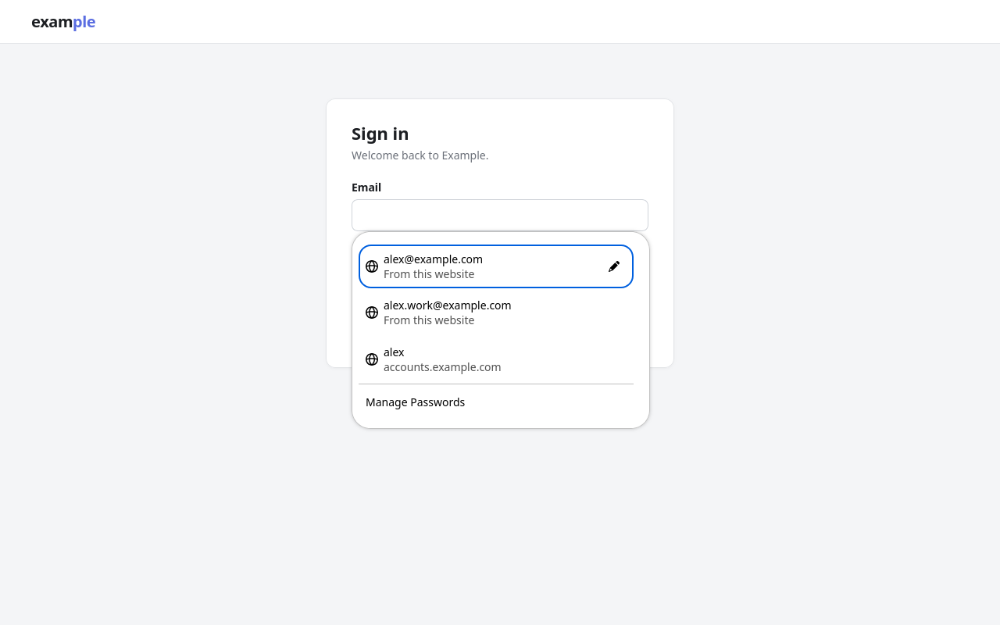
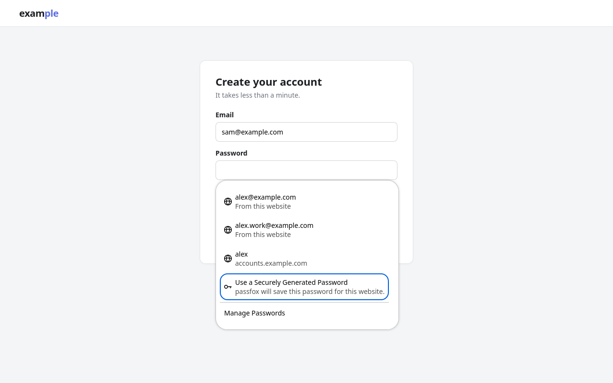
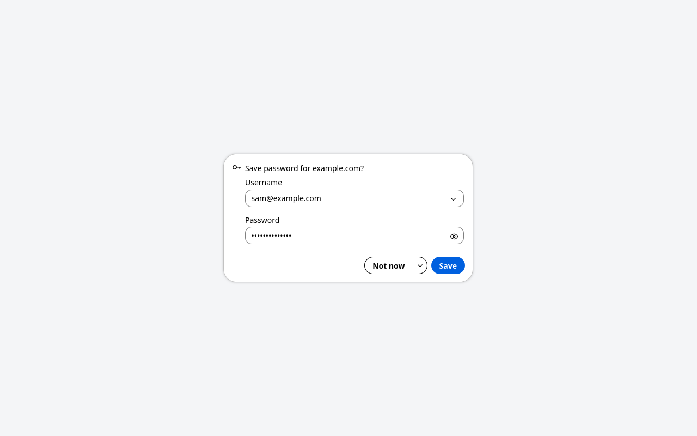
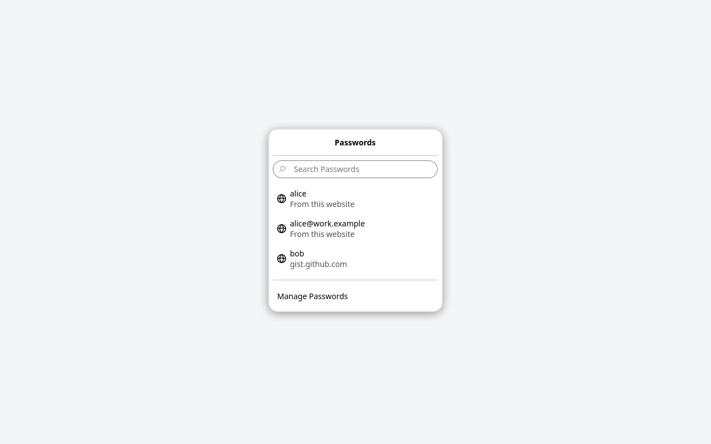

# passfox

[](https://github.com/AuthenticSm1les/passfox/actions/workflows/ci.yml)
[](https://github.com/AuthenticSm1les/passfox/releases/latest)
[](https://aur.archlinux.org/packages/passfox-host)
[](LICENSE)

**Your [pass](https://www.passwordstore.org/) passwords in Firefox, looking
and working like Firefox's own password manager.**

passfox fills logins from your pass store, offers to save new and changed
passwords back to it, and generates new ones with `pass generate`. It's built
from Firefox's own design, so the login dropdown and the save prompt look
just like Firefox's, in light and dark. Your passwords stay in pass: passfox
only connects it to Firefox.



| Generate passwords | Save new logins | Browse your logins |
| --- | --- | --- |
|  |  |  |

## What you need

- Firefox 142 or newer, on Linux or another unix-like system
- [pass](https://www.passwordstore.org/) with your logins stored as
  `www/<website>/<username>` (see [Your store](#your-store))
- Python 3
- To copy passwords: `wl-copy` (Wayland) or `xclip` (X11), the same tools
  pass uses for `pass show -c`

## Install

passfox comes in two parts: the Firefox add-on, and a small helper that lets
it run `pass` on your computer.

1. **Install the add-on** from
   [addons.mozilla.org](https://addons.mozilla.org/firefox/addon/passfox/).
2. **Install the helper.**
   - On Arch Linux, from the AUR:

     ```sh
     paru -S passfox-host
     ```

   - Anywhere else, download `passfox-host-<version>.tar.gz` from the
     [latest release](https://github.com/AuthenticSm1les/passfox/releases/latest),
     unpack it, and run:

     ```sh
     ./install.sh
     ```

3. **Pin passfox to the toolbar**: open the Extensions menu (the puzzle
   piece), click the gear next to passfox, and choose *Pin to Toolbar*. The
   save prompt opens under this button.

## Using passfox

### Fill a login

Click into a username or password field on a site you have logins for. A
dropdown lists the matching logins from your store; click one, or use the
↑ and ↓ keys and press Enter. passfox fills the username and password and
highlights them in yellow, as Firefox does.

Your gpg-agent decrypts the password, so pinentry may ask for your passphrase
just as `pass show` would.

### Save or update a login

After you sign in with a password passfox doesn't know yet, it asks
**Save password for example.com?** under its toolbar button. You can correct
the username (the ▾ lists the usernames from the form and your saved ones) and
check the password with the eye button before you click **Save**. If you
signed in with a new password for a saved login, it asks
**Update password for example.com?** instead.

Nothing is written until you click Save or Update. **Not now** leaves your
store alone, and **Never save** (under the ▾ next to it) stops asking for that
site. If you close the prompt by accident, click the passfox button within a
minute to get it back.

passfox can't tell whether a site accepted your password, so if a sign-in
fails, choose Not now.

### Generate a password

On sign-up and change-password forms, the password field's dropdown offers
**Use a Securely Generated Password**. passfox runs `pass generate` (with your
own pass length and character settings), fills the password and its
confirmation field, and shows the new password while the field has focus.

The new password is saved right away, as Firefox does, without a username at
first. After you submit the form, passfox asks
**Add username to saved password?** so the entry gets the right name.

### The toolbar button

Click the passfox button to see the logins for the site you're on: click a
login to fill it, or use the buttons beside it to copy the username or the
password. Passwords are copied with `pass show -c`, so pass clears the
clipboard again after its usual 45 seconds.

### Manage your passwords

**Manage Passwords** (in the toolbar panel and at the bottom of the login
dropdown) opens Firefox's own passwords page, `about:logins`, running on your
pass store. Search and sort your logins, and for each one:

- reveal or copy the password (pass decrypts just that entry when you ask,
  so pinentry may appear),
- **Edit** the website address, username or password: other lines in the
  entry are kept, and a new site or username renames the entry,
- **Remove** it, after confirming (`pass rm`; with a git-backed store,
  `pass git` can bring it back),
- or add a new login with the **+** button.

Logins show Firefox's default site icon, since passfox can't read Firefox's
favicon history.

## Your store

passfox reads website logins from the `www/` folder of your store, one entry
per login:

```
www/github.com/alice          → user alice on github.com
www/accounts.example.com/sam  → user sam on accounts.example.com
```

Logins for a site's subdomains are offered too, for example
`gist.github.com` logins on `github.com`. If an entry has a `login:`,
`username:`, `user:` or `email:` line, that's used as the username.

Entries passfox saves look like this, with the password on the first line:

```
<password>
login: alice
url: https://github.com
```

When passfox updates an entry, only the password line changes; every other
line is kept.

**Everything outside `www/` is left alone.** Tokens, TOTP seeds, keys and
notes elsewhere in your store are never shown, decrypted, copied or changed by
passfox.

## Settings

passfox follows your pass configuration, such as `PASSWORD_STORE_DIR`,
`PASSWORD_STORE_GENERATED_LENGTH`, `PASSWORD_STORE_CHARACTER_SET` and
`PASSWORD_STORE_CLIP_TIME`, as long as they're set in the environment Firefox
starts in.

If your logins live somewhere other than `www/`, set `PASSFOX_LOGIN_DIRS` to
the folder names, separated by colons (for example `www:web`).

## Privacy

passfox collects no data and makes no network requests. Passwords are only
decrypted when you fill, copy or save a login, by your own gpg-agent, and only
travel between Firefox and the helper on your computer.

## Troubleshooting

**No dropdown appears.** Check that the helper is installed: the passfox
toolbar panel says *Can't reach pass* when it isn't. Also check that the
site's logins are in `www/<website>/…`.

**The save prompt hangs from the puzzle piece.** Pin passfox to the toolbar
(see [Install](#install)).

**Copying a password does nothing.** Install `wl-copy` (Wayland) or `xclip`
(X11); pass needs one of them for `pass show -c`.

**pinentry doesn't appear.** passfox uses your gpg-agent like `pass` does; if
`pass show` works in a terminal but not from Firefox, set a graphical pinentry
(for example `pinentry-program /usr/bin/pinentry-gnome3` in
`~/.gnupg/gpg-agent.conf`).

## Contributing

Bug reports and pull requests are welcome on
[GitHub](https://github.com/AuthenticSm1les/passfox/issues). See
[CONTRIBUTING.md](CONTRIBUTING.md) for how passfox is built, tested and
released.

## License

[MPL-2.0](LICENSE). passfox includes design tokens, icons and styles from
Firefox, which are also under the MPL-2.0. passfox is an independent project
and isn't made or endorsed by Mozilla.
